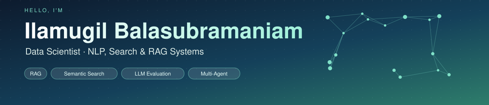
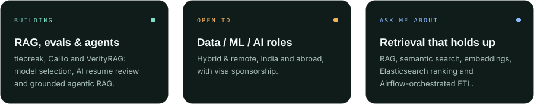
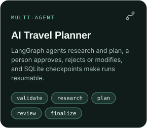
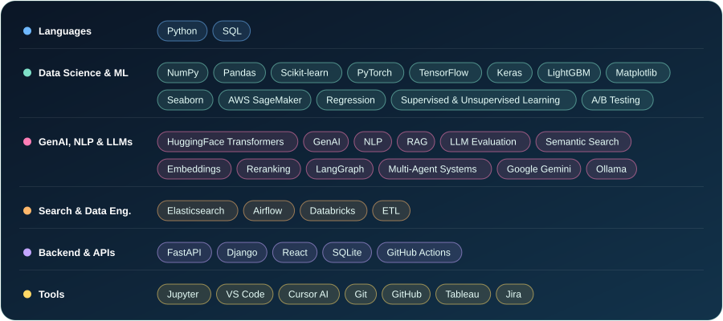

**Building agentic RAG & LLM-evaluation systems** &nbsp;·&nbsp; Semantic Search &nbsp;·&nbsp; Multi-Agent Workflows &nbsp;·&nbsp; Embeddings
 
🎯 Open to Data Scientist / ML Engineer / AI Engineer roles

### 👋 About Me

I'm a Computer Science & Engineering graduate and Data Scientist, focused on the retrieval layer of applied NLP — semantic search, ranking, and the RAG pipelines that sit behind AI assistants. I like turning messy, unstructured data into something a product can query reliably in real time. Right now I'm building and shipping end-to-end AI projects: model-selection tooling, multi-agent planners, and an AI resume & LinkedIn reviewer.

### 💡 Featured Projects

🌐 **Live:** [VerityRAG demo](https://verityrag.streamlit.app/) &nbsp;·&nbsp; [tiebreak site](https://mugil0095.github.io/tiebreak/)

<b>More projects</b>

- 🤖 [ATS Resume Analyzer — Gemini](https://github.com/mugil0095/ATS-Optimized-Resume-Analyzer-using-Gemini-Model) — scores resumes for ATS compatibility with Google's Gemini model and suggests targeted improvements.
- 🩺 [Gesture-Based Sterile Radiology Browser](https://github.com/mugil0095/A-Gesture-Based-Tool-For-Sterile-Browsing-Of-Radiology-Images) — touchless, gesture-controlled browsing of radiology images for sterile settings.
- 📄 [PDF Chatbot](https://github.com/mugil0095/PDF-Chatbot) — retrieval-based chatbot that answers questions directly from uploaded PDFs.

### 🛠️ Tech Stack

### 🧭 Journey

### 📊 GitHub Activity

<picture>
  <source media="(prefers-color-scheme: dark)" srcset="https://raw.githubusercontent.com/mugil0095/mugil0095/output/github-snake-dark.svg" />
  <source media="(prefers-color-scheme: light)" srcset="https://raw.githubusercontent.com/mugil0095/mugil0095/output/github-snake.svg" />
  
</picture>

  

 

**Most-starred project:** [Realtime Drowsiness Detection](https://github.com/mugil0095/Realtime-Drowsiness-Identification-Based-on-Eye-State-Analysis) ⭐

### 🎓 Certifications

### 📫 Let's Connect

